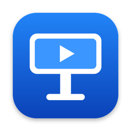
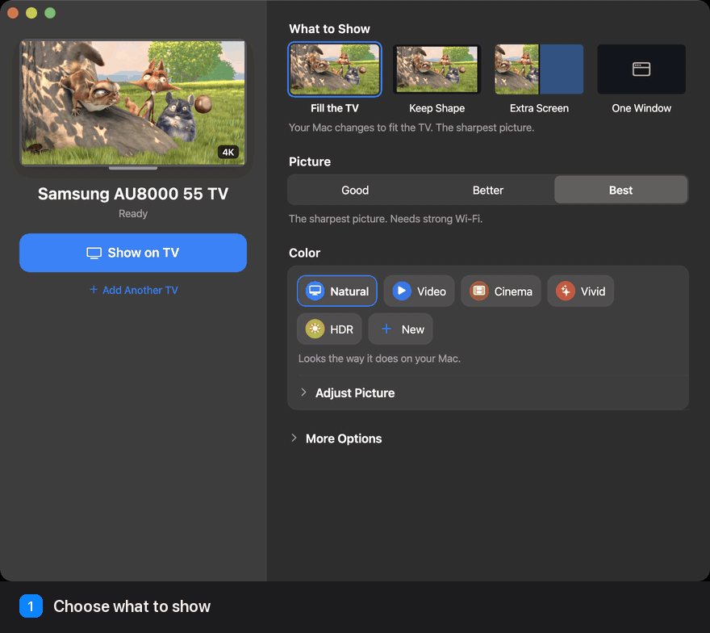

# Throwcast

**Your Mac on your Samsung TV in true 4K, at 60 FPS, over Wi-Fi.**

Cast your screen, a window, a second display or one browser tab. 
No stick, no cable.

<a href="../../releases/latest/download/Throwcast.dmg">
  <picture>
    <source media="(prefers-color-scheme: dark)" srcset="docs/download-macos-dark.png">
    
  </picture>
</a>

> [!NOTE]
> Only tested on a **Samsung AU8000 55"** (Tizen 6.5). Other Samsung TVs from 2020 on should work but haven't been tried, so [let us know](../../issues) how yours does.

## Why Throwcast

- **Real 4K, 2K or 1080p.** The TV gets its own resolution, not a stretched-up picture.
- **Steady 60 FPS.** Measured on the TV, 59.5 FPS on average with 0 dropped frames ([details](docs/DETAILS.md#a-real-cast-measured)).
- **Any browser tab.** Just the video, filling the TV, on almost any site, live streams included.
- **Sound where it belongs.** A cast tab plays on the TV, and your Mac keeps its own sound.
- **Simple.** Good, Better or Best, five color styles, and play controls on your Mac.

## Get started

1. **Mac:** download the DMG above and drag Throwcast to Applications.
2. **TV:** turn on Developer Mode and install the TV app from your Mac ([guide](docs/INSTALL.md#2-the-tv-app)).
3. **Browser:** load the extension in Chrome or Brave ([guide](docs/INSTALL.md#3-the-browser-extension)).

Then open Throwcast and press **Show on TV**.

## Learn more

- [Install guide](docs/INSTALL.md): every step, building from source and making a DMG
- [How it works](docs/DETAILS.md): resolution, the measured cast, how it got to 60 FPS, privacy, permissions and limits
- [Notices](NOTICE.md): credits, licenses and trademarks
- [Releasing](docs/RELEASING.md): building, signing and publishing the DMG, for maintainers

Demo film: <i>Big Buck Bunny</i> © Blender Foundation, <a href="https://creativecommons.org/licenses/by/3.0/">CC BY 3.0</a>. Throwcast is an independent project, not affiliated with Samsung, Apple or Google. See <a href="NOTICE.md">Notices</a>.

## License

Copyright © 2026 Hardik Kotangale. Throwcast is free software under the [GNU General Public License v3.0](LICENSE): use it, change it and share it, even commercially, as long as anything you distribute based on it is shared under the same license, with its source. Credits for the demo film and other open-source pieces are in [Notices](NOTICE.md).
