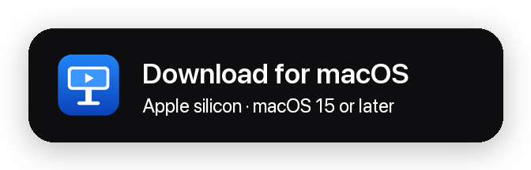
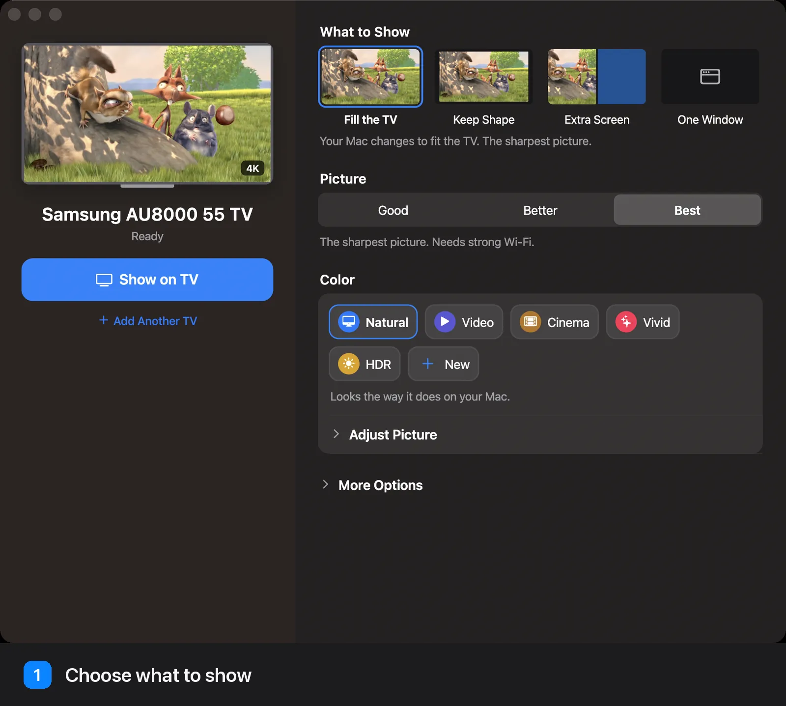
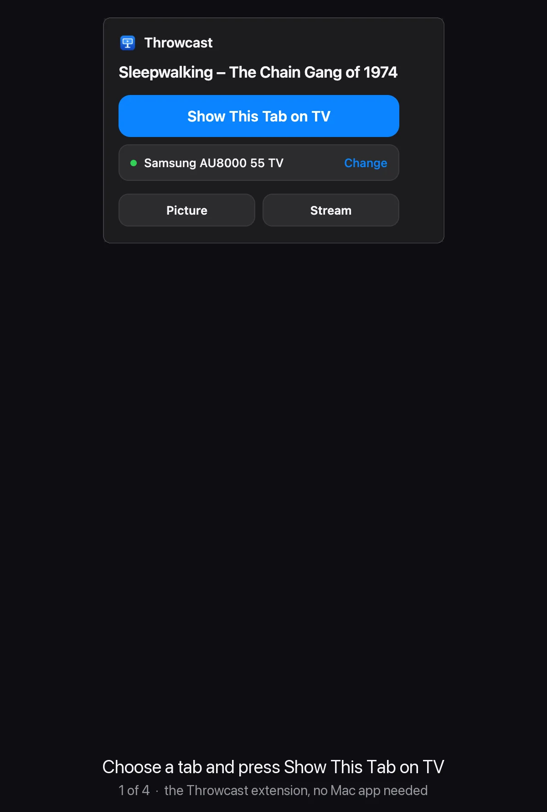
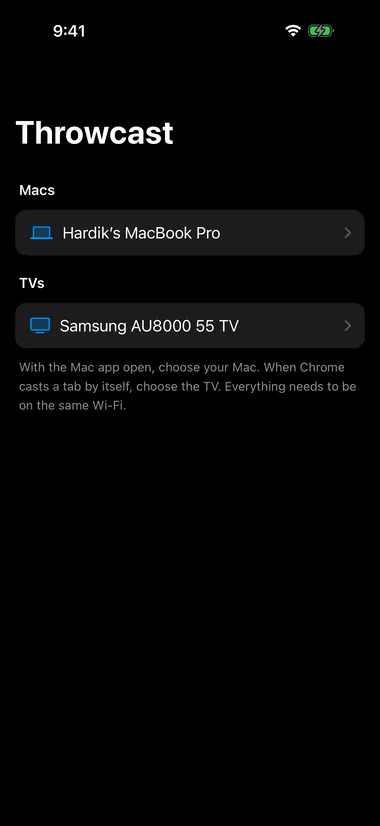

# Throwcast

**Your Mac on your Samsung TV in true 4K, at 60 FPS, over Wi-Fi.**

Cast your screen, a window, a second display or one browser tab. 
No stick, no cable.

<a href="../../releases/latest/download/Throwcast.dmg">
  <picture>
    <source media="(prefers-color-scheme: dark)" srcset="docs/assets/download-macos-dark.png">
    
  </picture>
</a>

> [!NOTE]
> Only tested on a **Samsung AU8000 55"** (Tizen 6.5). Other Samsung TVs from 2020 on should work but haven't been tried, so [let us know](../../issues) how yours does.

## Why Throwcast

- **Real 4K, 2K or 1080p.** The TV gets its own resolution, not a stretched-up picture.
- **Steady 60 FPS.** Measured on the TV, 59.5 FPS on average with 0 dropped frames ([details](docs/DETAILS.md#a-real-cast-measured)).
- **Delay you choose.** Smooth (0.4 s) for films, Balanced (0.1 s) for everyday use, or Instant (0.03 s) for mouse and typing, over TCP or UDP ([details](docs/DETAILS.md#delay-and-network)).
- **Any Apple silicon Mac.** Throwcast checks which hardware encoders your Mac has, HEVC or H.264, and offers only those.
- **Any browser tab, even without the Mac app.** The extension casts a tab to the TV by itself, in up to 4K at 60 FPS: the whole page, or just the video in full screen, with live streams, picture styles and stream settings.
- **Sound where it belongs.** A cast tab plays on the TV, keeps playing after the Mac sleeps, and your Mac keeps its own sound.
- **Control it from your iPhone.** Throwcast Remote starts and stops casts, plays, pauses and skips, and changes every setting, so the Mac can stay out of the way.
- **Knows what's playing.** During a screen or window cast, the Mac app reads the video in Chrome, Brave, Edge, Arc or Safari by itself, YouTube live included, and its play controls work from the Mac and the phone.
- **Simple for everyone.** Good, Better or Best, five color styles, play controls on your Mac, and every control works from the keyboard and with VoiceOver.

## The extension on its own

Only want to cast browser tabs? Install the TV app and the extension; the Mac app is optional.

- **Chrome does the work.** It captures the tab, encodes it on the Mac's hardware H.264 encoder and sends it straight to the TV over your Wi-Fi.
- **The whole page, or just the video.** The site works as usual on the TV; full screen fills the TV with the video, and Escape goes back.
- **Picture and Stream settings,** live during a cast: styles, sliders, quality, bitrate, frame rate, delay, and a Wi-Fi test.
- **Nothing in the background.** It runs only while a tab is on the TV.

The Mac app adds your whole screen, One Window, Extra Screen, HEVC, HDR and UDP ([what each can do](docs/DETAILS.md#the-extension-on-its-own)).

  

## The iPhone remote

Throwcast Remote is an optional iPhone app that controls a cast from wherever you're sitting.

- **With the Mac app:** start and stop a cast, choose the TV and what to show, play, pause, scrub, skip ±10 s, next and previous, LIVE, and every Mac app setting: quality, resolution, bitrate, frame rate, delay, TCP or UDP, codec, picture and volume. The Mac and the phone always show the same settings.
- **With only the extension:** it connects to the TV and controls what's playing, the picture, the picture size, the stream and the volume.
- **Pair once.** The Mac asks you to allow the phone, or the TV shows a code to type. Phones that aren't paired can't see or control anything, and a phone can never send a link to your TV.

An iPhone only installs apps from the App Store, TestFlight or Xcode, so it isn't in the DMG: build it once from `ios/` with Xcode ([guide](docs/INSTALL.md#4-the-iphone-remote-optional)).

  

## Get started

1. **Mac:** download the DMG above and drag Throwcast to Applications.
2. **TV:** turn on Developer Mode and install the TV app from your Mac ([guide](docs/INSTALL.md#2-the-tv-app)).
3. **Browser:** load the extension in Chrome or Brave ([guide](docs/INSTALL.md#3-the-browser-extension)).
4. **iPhone (optional):** build Throwcast Remote with Xcode ([guide](docs/INSTALL.md#4-the-iphone-remote-optional)).

Then open Throwcast and press **Show on TV**. To cast just a browser tab, the extension also works on its own, without the Mac app.

## If it doesn't connect

| Message on your Mac | What to do |
| --- | --- |
| **Throwcast isn't installed on this TV yet.** | Install the TV app ([guide](docs/INSTALL.md#2-the-tv-app)). |
| **Couldn't open Throwcast on the TV.** | Open Throwcast from the TV's Apps screen, then press **Show on TV** again. |
| **The TV didn't connect.** | One Mac casts at a time, and the first one keeps the TV. If someone else is casting, wait until they stop. |

## Learn more

- [Install guide](docs/INSTALL.md): every step, building from source, and uninstalling cleanly
- [How it works](docs/DETAILS.md): resolution, delay and network, the measured cast, how it got to 60 FPS, the iPhone remote, privacy, permissions and limits
- [Notices](NOTICE.md): credits, licenses and trademarks
- [Releasing](docs/RELEASING.md): building, signing and publishing the DMG, for maintainers

Demo film: <i>Big Buck Bunny</i> © Blender Foundation, <a href="https://creativecommons.org/licenses/by/3.0/">CC BY 3.0</a>. Throwcast is an independent project, not affiliated with Samsung, Apple or Google. See <a href="NOTICE.md">Notices</a>.

## License

Copyright © 2026 Hardik Kotangale. Throwcast is free software under the [GNU General Public License v3.0](LICENSE): use it, change it and share it, even commercially, as long as anything you distribute based on it is shared under the same license, with its source. Credits for the demo film and other open-source pieces are in [Notices](NOTICE.md).
